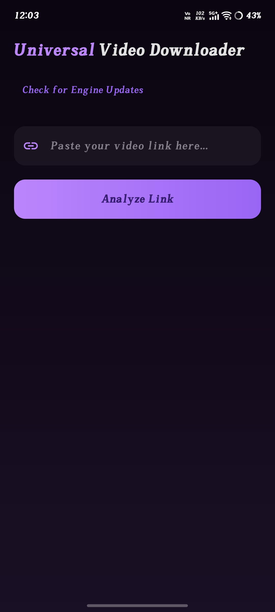
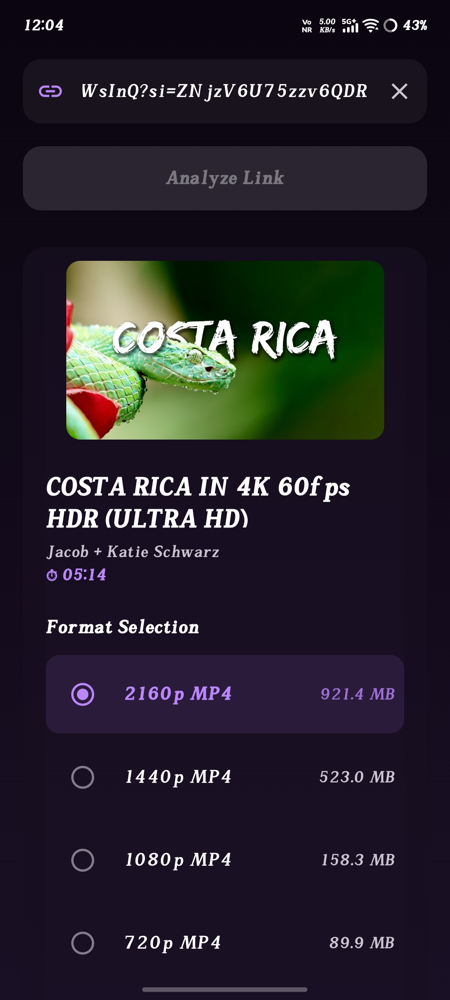
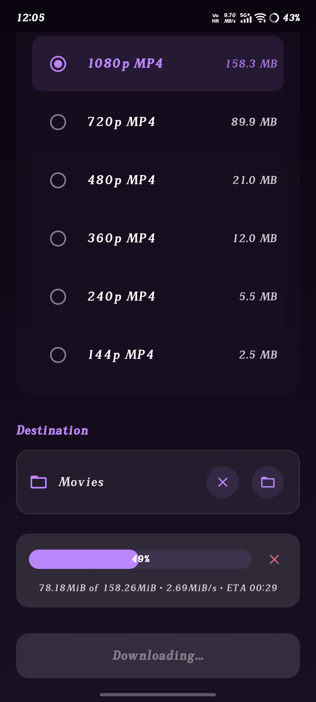

  

<h1 align="center">Universal Video Downloader</h1>

  <a href="https://github.com/biswaspratyay/Universal_Video_Downloader/releases/latest">
    
 

  <b>A clean, ad-free video and audio downloader powered by yt-dlp.</b> 
  <b>Available for Windows, Linux and Android.</b>

---

Universal Video Downloader is a modern cross-platform frontend for **yt-dlp** and **FFmpeg**, designed to make downloading media simple without sacrificing flexibility. Whether you're on desktop or Android, it provides a clean interface for analyzing videos, choosing formats, and managing downloads.

See the [changelog](CHANGELOG.md) for the v1.3 updates.

## Features

* **Cross-Platform:** Native applications for Windows, Linux, and Android.
* **Wide Site Support:** Download video and audio from hundreds of websites supported by `yt-dlp`.
* **Format Analyzer:** Preview available formats, codecs, bitrate, resolution, and estimated file sizes before downloading.
* **Video Preview:** Instantly fetch thumbnails and detailed metadata.
* **Download Manager:** Real-time progress, speed, ETA, pause, resume, cancel, and automatic cleanup of partial downloads.
* **Playlist Support:** Analyze YouTube playlists and download either the entire playlist or selected videos.
* **Bundled FFmpeg:** Desktop releases include FFmpeg, so no additional setup is required.

## Tech Stack

| Component | 🖥️ Desktop | 📱 Android |
|-----------|------------|------------|
| **Language** | [Python](https://www.python.org/) | [Kotlin](https://kotlinlang.org/) |
| **UI Framework** | [PySide6 (Qt for Python)](https://doc.qt.io/qtforpython/) | [Jetpack Compose](https://developer.android.com/jetpack/compose) |
| **Design System** | Qt Widgets | [Material 3](https://m3.material.io/) |
| **Download Engine** | [yt-dlp](https://github.com/yt-dlp/yt-dlp) | [yt-dlp](https://github.com/yt-dlp/yt-dlp) via [youtubedl-android](https://github.com/junkfood02/youtubedl-android) |
| **Media Processing** | [FFmpeg](https://ffmpeg.org/) | Built into the download engine |
| **Networking** | [Requests](https://requests.readthedocs.io/) | Native Android networking |
| **Image Loading / Processing** | [Pillow](https://python-pillow.org/) | [Coil](https://coil-kt.github.io/coil/) |
| **Local Storage** | File System | [Jetpack DataStore](https://developer.android.com/topic/libraries/architecture/datastore) |
| **Architecture** | Modular Python Application | MVVM, Kotlin Coroutines & Flow |
| **Packaging** | [PyInstaller](https://pyinstaller.org/) | APK / Android App Bundle (AAB) |

## Installation

### Windows

1. Download the latest **Windows** release from the [Releases](https://github.com/biswaspratyay/Universal_Video_Downloader/releases/latest) page.
2. Extract the archive.
3. Launch `UniversalVideoDownloader.exe`.

> **Note:** Since the application isn't code-signed yet, Windows SmartScreen may display a warning. Click **More info** → **Run anyway**.

### Linux

Download the latest Linux release from the Releases page and follow the instructions included with the release package.

### Android

Download the latest APK from the Releases page and install it on your device. If prompted, allow installation from unknown sources.
>**If you face any error while downloading any file, just click on the "Check for Engine Update" button. This will update the download engine and the download will perform normally.** 

## Download

| Platform | Package |
|----------|---------|
| **Windows** | `UniversalVideoDownloader-v1.3-Windows-x64.zip` |
| **Linux** | `UniversalVideoDownloader-v1.3-Linux-x64.tar.gz` |
| **Android** | `UniversalVideoDownloader-v1.3-Android-arm64-v8a.zip` |

### Want to build or modify the project?

Download **Source code (zip)** or **Source code (tar.gz)** from the Releases page.

> **Note:** Source archives contain the project files only—they are not pre-built applications.

## Usage

Paste a supported URL, click **Analyze**, choose your preferred format or quality, and press **Download**.

On desktop, you can also drag and drop supported URLs directly into the application window.

## Screenshots

### Desktop

<i>Clean interface designed to keep everything in one place.</i>

---

<b>Paste URL</b> &nbsp;&nbsp;&nbsp;&nbsp;&nbsp;&nbsp;&nbsp;&nbsp;&nbsp;&nbsp;&nbsp;&nbsp;&nbsp;&nbsp;&nbsp;&nbsp;
<b>Analyze Video</b>

---

<i>Track download progress with live speed, ETA, and status updates.</i>

### Mobile

  

  <i>Analyze a video and preview available formats.</i>

---

  

  <i>Select your preferred quality before downloading.</i>

---

  

  <i>Monitor download progress with real-time speed and ETA.</i>

## License & Contributing

Licensed under the **MIT License**.

Bug reports, feature requests, and pull requests are always welcome.

If you find this project useful, consider giving it a ⭐.
